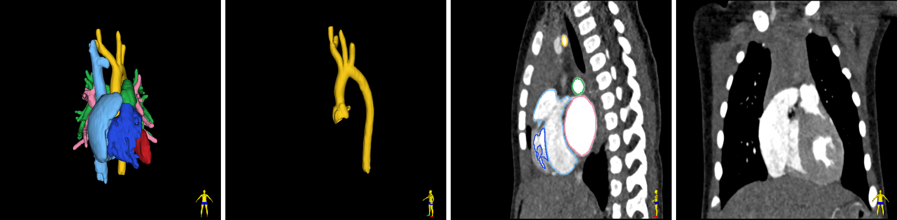

# slicer-mcp

An MCP server that lets vision-language-model agents operate [3D Slicer](https://www.slicer.org). The model examines
a volumetric scan through named, bounded tools (3D view control, rendering presets, clipping, slices, measurements, segmentation
display); there is no code execution. Every call is logged with its arguments, the resulting state and the images,
so a session can be audited, replayed and scored.


Example views returned to the model (segmentation shells in 3D, one structure isolated, sagittal and coronal slices):



```
MCP client ──stdio──► slicer-mcp serve --profile P ──HTTP 127.0.0.1 + token──► 3D Slicer + SlicerMCPBridge
                      (validates and clamps arguments,                          (renders 3D, axial, sagittal,
                       enforces the tool allowlist, writes the trace)            coronal views)
```

Version 0.1.0 (research release). The 0.1.0 tool surface is frozen so results stay reproducible; see
[ROADMAP.md](ROADMAP.md).

## Features

- **Secure:** only named, typed tools; no exec route; the bridge listens on 127.0.0.1 and requires a per-launch token.
- **Clinical input:** DICOM folders, NIfTI, NRRD, converted to temporary anonymised cases.
- **Task profiles:** one folder sets the tool allowlist, image size, presets, bounds and the report format.
- **Auditable:** per-call traces stamped with the profile's hashes; `replay` re-renders a trace and compares frames.
- **Headless and parallel:** runs on a Linux server without a GPU or a screen, one Slicer per port.

## Installation

Requirements: Linux or macOS, [uv](https://docs.astral.sh/uv/), and
[3D Slicer 5.10.0](https://download.slicer.org/) (macOS: the x86_64 build; Linux servers: see
[Headless Linux](#headless-linux)).

```bash
git clone https://github.com/Maitri-Labs-Amrita/slicer-eval-mcp.git
cd slicer-eval-mcp
uv sync --inexact
```

Machine settings (Slicer path, bridge port, data folders) go in `config/runtime.local.json`, a copy of
`config/runtime.json`; pass it with `--runtime` or `SLICER_MCP_RUNTIME`. The default Slicer path is the macOS one.

**As a dependency of another project.** The package ships the Slicer bridge and its helper scripts, so it can be
installed like any library, pinned to a commit:

```bash
uv add "slicer-mcp @ git+https://github.com/Maitri-Labs-Amrita/slicer-eval-mcp@<commit>"
```

Installed this way, relative paths in the runtime config (cases, traces, logs) are relative to the working folder.

## Quick start

```bash
uv run slicer-mcp launch --profile ct_basic                 # start Slicer with the bridge
uv run slicer-mcp case prepare --volume scan.nii.gz         # or --dicom <folder>; prints case_id and lease
uv run slicer-mcp serve --profile ct_basic                  # the MCP server (your client starts it over stdio)
uv run slicer-mcp case remove <case_id> --lease <lease>
uv run slicer-mcp launch --stop
```

To try it without a model, run the scripted client, which calls every tool:

```bash
uv run python examples/scripted_episode.py out/ <case_id> slicer_mcp/ -- uv run slicer-mcp serve --profile ct_basic
```

Traces go to `traces/<episode_id>/` (`steps.jsonl`, `frames/`, the report).

## Using it from an MCP client

After `launch` and `case prepare` (Quick start), a client runs one episode like this:

```python
import asyncio, json
from mcp import Client, StdioServerParameters

async def main():
    server = StdioServerParameters(command="uv", args=["run", "slicer-mcp", "serve", "--profile", "ct_basic"])
    async with Client(server) as c:
        tools = [t for t in (await c.list_tools()).tools
                 if not (t.meta or {}).get("slicer_mcp/runner_only")]   # give only these to the model
        await c.call_tool("reset_episode", {"case_id": "<case_id>"})    # load the case (runner only)
        res = await c.call_tool("orbit", {"azimuth_deg": 30})           # a model's tool call
        print(json.loads(res.content[0].text)["state"])
        await c.call_tool("end_episode", {})                            # close the episode (runner only)

asyncio.run(main())
```

- Each result is one JSON text block `{step_index, state, result, warnings, error, frames}` followed by one PNG per
  view in `frames`.
- The model ends the session with `submit_report`. By default it takes any JSON object; a report plugin
  (`serve --report plugin.py`, example in [examples/report_plugin.py](examples/report_plugin.py)) defines and
  validates your own format. Plugins are trusted code.

## Profiles

A profile is a folder with `protocol.json` (tools, bounds, presets, classes), optional `presets.xml` and an optional
`report.py`. Two examples ship here: `ct_basic` (17 tools, no segmentation) and `ct_segments` (22 tools, a label map
shown as hollow shells):

```bash
uv run slicer-mcp case prepare --profile ct_segments --volume ct.nii.gz --labels labels.nii.gz \
    --label-map 1=liver,2=spleen,3=kidney_left,4=kidney_right,5=aorta,6=pancreas
```

Bring your own with `--profile /path/to/profile`. Tool references, generated from the code:
[docs/tools/ct_basic.md](docs/tools/ct_basic.md), [docs/tools/ct_segments.md](docs/tools/ct_segments.md). All
commands and options: [docs/CLI.md](docs/CLI.md).

## Headless Linux

```bash
uv run slicer-mcp setup-headless    # Xvfb, Slicer 5.10.0 and missing libraries, no sudo; writes config/runtime.local.json
uv run slicer-mcp xvfb-session --runtime config/runtime.local.json -- bash   # a shell on a virtual display
```

For parallel runs, give each job its own runtime copy with `"bridge_port": "auto"` and its own state file, cases and
traces folders. Mesa (CPU) frames differ slightly from GPU frames, so keep one comparison on one kind of machine.

## Tests

```bash
uv run pytest -q                        # unit tests, no Slicer
uv run pytest -m slicer tests/slicer    # live tests: a running launch and SLICER_MCP_TEST_VOLUME=<your CT>
```

See [CONTRIBUTING.md](CONTRIBUTING.md).

## Citation

```bibtex
@inproceedings{TODO,
  title     = {TODO},
  author    = {TODO},
  booktitle = {TODO},
  year      = {TODO}
}
```

## License

Apache-2.0 ([LICENSE](LICENSE)).
