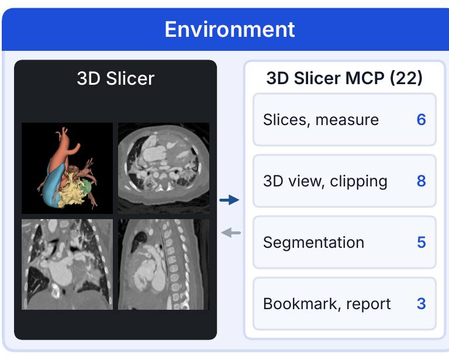

# slicer-mcp

An MCP server that lets vision-language-model agents operate [3D Slicer](https://www.slicer.org). The model examines
a volumetric scan through named tools (3D view control, rendering presets, clipping, slices, measurements, segmentation
display); there is no code execution. Every call is logged with its arguments, the resulting state and the images,
so a session can be audited, replayed and scored.



Example views returned to the model (segmentation shells in 3D, one structure isolated, sagittal and coronal slices):


```
MCP client ──stdio──► slicer-mcp serve --profile P ──HTTP 127.0.0.1 + token──► 3D Slicer + SlicerMCPBridge
                      (validates and clamps arguments,                          (renders 3D, axial, sagittal,
                       enforces the tool allowlist, writes the trace)            coronal views)
```

Version 0.1.0. The tools are frozen at this version so results reproduce.

## Features

- **Secure:** only named, typed tools; no exec route; the bridge listens on 127.0.0.1 and requires a per-launch token.
- **Clinical input:** DICOM folders, NIfTI, NRRD, converted to temporary anonymised cases.
- **Task profiles:** one folder sets the tool allowlist, image size, presets, bounds and the report format.
- **Auditable:** per-call traces stamped with the profile's hashes; `replay` re-renders a trace and compares frames.
- **Headless and parallel:** runs on a Linux server without a GPU or a screen, one Slicer per port.

## Requirements

- Linux or macOS
- [uv](https://docs.astral.sh/uv/)
- [3D Slicer 5.10.0](https://download.slicer.org/) (macOS: the x86_64 build). On a Linux server, `setup-headless`
  installs it for you ([Headless Linux](#headless-linux)).

## Install

```bash
git clone https://github.com/Maitri-Labs-Amrita/slicer-eval-mcp.git
cd slicer-eval-mcp
uv sync --inexact
```

Then tell slicer-mcp where 3D Slicer is on your machine. On a Linux server, `uv run slicer-mcp setup-headless`
does this. Otherwise:

```bash
cp config/runtime.json config/runtime.local.json      # your copy (gitignored)
export SLICER_MCP_RUNTIME=config/runtime.local.json   # every slicer-mcp command now reads it
```

In `config/runtime.local.json`, set `slicer_executable` to your Slicer, e.g.
`"/Applications/Slicer.app/Contents/MacOS/Slicer"` (macOS, the default) or
`"/opt/Slicer-5.10.0-linux-amd64/Slicer"` (Linux). The file also sets the local port Slicer listens on
(`bridge_port`, 2017) and the folders for prepared cases (`cases_dir`) and run traces (`traces_dir`).

**As a dependency of another project.** The package ships the Slicer bridge and its helper scripts, so it can be
installed like any library, pinned to a commit:

```bash
uv add "slicer-mcp @ git+https://github.com/Maitri-Labs-Amrita/slicer-eval-mcp@<commit>"
```

Installed this way, relative paths in the runtime config (cases, traces, logs) are relative to the working folder.

## Quick start

On a Linux server without a screen, first open a shell on a virtual display and run everything below inside it:

```bash
uv run slicer-mcp xvfb-session --runtime config/runtime.local.json -- bash
```

```bash
uv run slicer-mcp launch --profile ct_basic                 # start Slicer with the bridge
uv run slicer-mcp case prepare --volume scan.nii.gz         # or --dicom <folder>; prints case_id and lease
# ... run your client (next sections); it starts `slicer-mcp serve` itself
uv run slicer-mcp case remove <case_id> --lease <lease>
uv run slicer-mcp launch --stop
```

To try it without a model, run the scripted client, which calls every tool:

```bash
uv run python examples/scripted_episode.py out/ <case_id> slicer_mcp/ -- \
    uv run slicer-mcp serve --profile ct_basic --runtime config/runtime.local.json
```

`out/` gets the replies; `slicer_mcp/` is the prefix of the extra fields it logs with each call. With `ct_basic`,
the 5 segmentation tools are refused: that shows the tool allowlist working, not a failure. Traces go to
`traces/<episode_id>/` (`steps.jsonl`, `frames/`, the report).

## Use from your own runner

This is the intended use: an evaluation runner starts the server, loads a case and passes the model's tool calls
through. After `launch` and `case prepare`:

```python
import asyncio, json
from mcp import Client, StdioServerParameters

async def main():
    server = StdioServerParameters(command="uv", args=["run", "slicer-mcp", "serve", "--profile", "ct_basic",
                                                       "--runtime", "config/runtime.local.json"])
    async with Client(server) as c:
        tools = [t for t in (await c.list_tools()).tools
                 if not (t.meta or {}).get("slicer_mcp/runner_only")]   # give only these to the model
        await c.call_tool("reset_episode", {"case_id": "<case_id>"})    # load the case (runner only)
        res = await c.call_tool("orbit", {"azimuth_deg": 30})           # a model's tool call
        print(json.loads(res.content[0].text)["state"])
        await c.call_tool("end_episode", {})                            # close the episode (runner only)

asyncio.run(main())
```

- Each result is one JSON text block `{step_index, state, result, warnings, error, frames}` followed by one PNG per
  view in `frames`.
- The model ends the session with `submit_report`. By default it takes any JSON object; a report plugin
  (`serve --report plugin.py`, example in [examples/report_plugin.py](examples/report_plugin.py)) defines and
  validates your own format.

## Use from an MCP host

To try it interactively in an MCP host (Claude Desktop, VS Code, Cursor, ...), run `launch` and `case prepare`
first, then add the server to the host's MCP configuration (for Claude Desktop, `claude_desktop_config.json`):

```json
{
  "mcpServers": {
    "slicer": {
      "command": "uv",
      "args": ["--directory", "/path/to/slicer-eval-mcp", "run", "slicer-mcp", "serve",
               "--profile", "ct_basic", "--runtime", "config/runtime.local.json"]
    }
  }
}
```

A host shows the model every tool, including the runner-only ones, so the model calls `reset_episode` with the
`case_id` itself. For evaluations, use your own runner, which hides them.

## Tools

The `ct_segments` profile has all 22 model tools; `ct_basic` has 17 (no segmentation tools). Full descriptions and
argument schemas, exactly as the model receives them: [docs/tools/ct_basic.md](docs/tools/ct_basic.md),
[docs/tools/ct_segments.md](docs/tools/ct_segments.md).

| Group | Tool | What it does |
|---|---|---|
| Slices | `set_slice` | Move one slice view to a position in mm along its axis |
| | `scroll_slice` | Scroll one slice view by a number of slices |
| | `set_window_preset` | Set the grey-scale window/level of the slice views to a preset |
| | `jump_to_point` | Move all three slice views through a point [R, A, S] |
| | `point_at` | Point at a pixel of a slice image: its position and intensity |
| | `measure` | Measure the distance in mm between two pixels of a slice image |
| 3D view | `orbit` | Rotate the 3D camera about its focal point |
| | `set_view_direction` | Look at the patient from one side (anterior, left, superior, ...) |
| | `zoom` | Zoom the 3D view, or with `view: "slices"` the slice views (0.25 to 4 per call) |
| | `pan_to` | Move the 3D camera's focal point to a point |
| | `set_render_preset` | Change the volume-rendering preset |
| | `set_clip_box` | Crop the 3D rendering to a box |
| | `set_clip_plane` | Cut away one side of the 3D rendering with a plane |
| | `clear_clip` | Remove the clip box or plane |
| Segmentation (`ct_segments`) | `set_segment_visibility` | Show or hide individual structure shells |
| | `set_segment_opacity` | Set the 3D opacity of one structure shell, or of all |
| | `set_3d_content` | Show the shells alone, inside the CT, or the CT alone |
| | `set_slice_outlines` | Turn the structure outlines on the slices on or off |
| | `center_on_segments` | Centre the 3D view on chosen structures |
| Episode | `bookmark_view` | Save the current view as evidence (`v001`, `v002`, ...) |
| | `reset_view` | Restore the initial view |
| | `submit_report` | Submit the final report (JSON) |
| Runner only | `reset_episode` | Load a case and start an episode |
| | `end_episode` | Close the open episode |
| | `observe` | Capture the current views without changing them |

## Profiles

A profile defines the task the model gets: which tools it may call, the allowed range of each argument, the window
and render presets, the image size, the segmentation structures and the report format. The server stays the same;
you change what the model can see and do by changing the profile. Each trace records the profile's hashes, so a
result names the exact setup it came from. For example, CHD-Bench's three settings (full, no 3D view, no
segmentation) are three profiles of this server.

A profile is a folder:

| File | Sets |
|---|---|
| `protocol.json` | the tool allowlist, argument bounds, presets, image size and segmentation structures |
| `presets.xml` (optional) | the profile's own volume-rendering presets, added to Slicer's stock ones |
| `report.py` (optional) | the report format `submit_report` accepts, and its validation |

Two examples ship here: `ct_basic` (17 tools, no segmentation) and `ct_segments` (22 tools, a label map shown as
hollow shells). A profile with a segmentation needs the label map when you prepare the case:

```bash
uv run slicer-mcp case prepare --profile ct_segments --volume ct.nii.gz --labels labels.nii.gz \
    --label-map 1=liver,2=spleen,3=kidney_left,4=kidney_right,5=aorta,6=pancreas
```

Bring your own with `--profile /path/to/profile`. All commands and options: [docs/CLI.md](docs/CLI.md).

## Headless Linux

```bash
uv run slicer-mcp setup-headless    # Xvfb, Slicer 5.10.0 and missing libraries, no sudo; writes config/runtime.local.json
uv run slicer-mcp xvfb-session --runtime config/runtime.local.json -- bash   # a shell on a virtual display
```

For parallel runs, give each job its own runtime copy with `"bridge_port": "auto"` and its own state file, cases and
traces folders. Mesa (CPU) frames differ slightly from GPU frames, so keep one comparison on one kind of machine.

## Security

- The model can only call the profile's named tools. Any other call is refused and logged. There is no code
  execution: the bridge has no exec route.
- Every argument is validated against its schema and the profile's bounds; out-of-range values are clamped, with a
  warning in the result.
- The bridge listens on 127.0.0.1 only and needs the token of the current launch.
- `case prepare` copies the scan into a temporary anonymised case, so the model never sees file names or patient
  fields. It cannot remove text burned into the images: use de-identified scans.
- Report plugins (`serve --report`) are Python that runs in the server: use only plugins you trust.

## Tests

```bash
uv run pytest -q                        # unit tests, no Slicer
uv run pytest -m slicer tests/slicer    # live tests: a running launch and SLICER_MCP_TEST_VOLUME=<a CT file, e.g. NIfTI>
```

See [CONTRIBUTING.md](CONTRIBUTING.md).

## License

Apache-2.0 ([LICENSE](LICENSE)).
